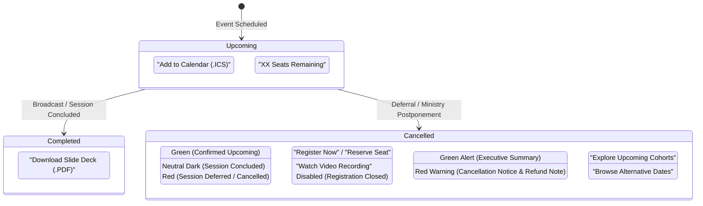

# Open ECDL — Phase 05: Training Calendar, Webinars & Events Specification

## 1. Executive Summary

This specification outlines the technical architecture, data model, user experience, and WordPress / Tutor LMS Pro integration mapping for **Phase 05: Training Calendar and Events** on the **Open ECDL** ([open.ecdl.com.bd](https://open.ecdl.com.bd)) platform.

The system delivers three core routes:
1. `/training-calendar` — Interactive month and list view calendar with timezone awareness (`Asia/Dhaka`), delivery-mode and category filtering, date selection preview, and RFC 5545 `.ics` export.
2. `/webinars` — Virtual policy briefings and executive webinar hub featuring live countdown timers, Upcoming vs. Past (On-Demand) tabs, and an accessible registration modal with client-side validation and simulated confirmation.
3. `/events/:slug` — Comprehensive event detail template supporting **Upcoming Confirmed**, **Completed (with On-Demand resources)**, and **Cancelled/Deferred** states.

---

## 2. Information Architecture & Clean Routing

| Frontend URL Route | File Architecture | Elementor / WordPress Template Mapping | Description |
| :--- | :--- | :--- | :--- |
| `/training-calendar` | `training-calendar.html`<br>`assets/css/calendar.css`<br>`assets/js/calendar.js` | Elementor Archive Template: `archive-ecdl_event.php` | 7-day responsive month grid & chronological agenda view with `.ics` export. |
| `/webinars` | `webinars.html`<br>`assets/css/webinars.css`<br>`assets/js/webinars.js` | Elementor Archive Template: `archive-ecdl_webinar.php` | Featured policy briefing banner, countdown timer, Upcoming/Past tabs, registration modal. |
| `/events/:slug` | `event-detail.html`<br>`assets/css/event-detail.css`<br>`assets/js/event-detail.js` | Elementor Single Event Template: `single-ecdl_event.php` | 6 main column sections + sticky booking card with visual states for all 3 statuses. |

---

## 3. Data Schema & Model Specification

In the prototype, data is managed by `assets/data/mock-data.js` via the `OpenECDLMockData.events` collection. When migrated to WordPress, this maps directly to a custom post type `ecdl_event` managed by the **ECDL Core** plugin and ACF Pro.

```json
{
  "id": "evt-labour-briefing-2026",
  "slug": "2026-bangladesh-labour-law-amendment-briefing",
  "title": "Executive Policy Briefing: 2026 Bangladesh Labour Act Gazette Amendments & Workplace Impact",
  "type": "webinar",
  "category": "Compliance Management",
  "categorySlug": "compliance-management",
  "deliveryMode": "Live Online",
  "startDate": "2026-12-10T15:00:00+06:00",
  "endDate": "2026-12-10T16:30:00+06:00",
  "dateFormatted": "Dec 10, 2026",
  "timeFormatted": "03:00 PM – 04:30 PM (BST)",
  "timezone": "Asia/Dhaka (BST • UTC+6)",
  "duration": "90 Minutes",
  "location": "Live Interactive Zoom Broadcast",
  "venue": "High-Definition Zoom Webinar Broadcast with Real-Time Q&A & Document Chat",
  "status": "upcoming",
  "isFeatured": true,
  "fee": "Complimentary Access (Pre-Registration Required)",
  "priceType": "free",
  "seats": "140 Virtual Seats Remaining",
  "summary": "An authoritative statutory breakdown...",
  "about": "The 2026 gazette amendments to the Bangladesh Labour Act 2006...",
  "outcomes": [
    "Understand Section-by-Section legal updates in 2026 Labour amendments",
    "Factory inspection readiness checklist and DIFE audit defense protocols"
  ],
  "speakers": [
    {
      "name": "Advocate Rafiqul Islam",
      "title": "LL.M (DU), Advocate, Supreme Court of Bangladesh",
      "role": "Lead Legal Faculty & Advisor",
      "organization": "Supreme Court of Bangladesh / ECDL Advisory Panel",
      "avatar": "https://images.unsplash.com/photo-1560250097-0b93528c311a?auto=format&fit=crop&w=300&q=80",
      "bio": "18+ years trial practice before the Labour Court..."
    }
  ],
  "agenda": [
    { "time": "03:00 PM – 03:10 PM", "title": "Welcome & Executive Framework", "speaker": "ECDL Leadership", "description": "Opening address..." }
  ],
  "faqs": [
    { "q": "Is there any fee to attend?", "a": "No, this briefing is complimentary." }
  ],
  "resources": {
    "recordingUrl": "https://www.youtube.com/watch?v=mock-esg-webinar",
    "recordingDuration": "1h 28m",
    "slidesUrl": "assets/docs/ECDL-ESG-Due-Diligence-Masterclass-2026.pdf",
    "executiveSummary": "A complete recap of European Union CSDDD mandates..."
  },
  "cancellationNotice": "Notice of Session Deferral: Following the official scheduling of tripartite gazette committee deliberations...",
  "relatedEventSlugs": ["bangladesh-labour-act-masterclass-dec2026"]
}
```

---

## 4. Training Calendar UX & Engineering Details

### Timezone Precision
* **Standard Timezone:** `Asia/Dhaka (BST • UTC+6)`
* All start and end timestamps are stored in ISO 8601 strings with timezone offset (`+06:00`).
* Timestamps displayed to users explicitly reference `(BST)` to eliminate confusion for regional multinational participants.

### Month Grid Responsiveness (Anti-Overflow Layout)
* Desktop (>= 769px): Displays 7 columns (Sunday to Saturday) with date number, event count badges, and up to two text event chips per day.
* Mobile (<= 768px): Uses fluid CSS grid where day cells display compact date numbers and colored status dots (`.ecdl-calendar-dot`).
* Clicking any day on mobile smoothly scrolls down to the **Selected Date Programme Preview Panel**, presenting full session cards without causing horizontal page scroll.

### RFC 5545 Calendar Export (.ics)
Client-side `.ics` generation creates an RFC 5545 standard file formatted as:
```ics
BEGIN:VCALENDAR
VERSION:2.0
PRODID:-//Enroute Center for Development//Open ECDL Events//EN
CALSCALE:GREGORIAN
METHOD:PUBLISH
BEGIN:VEVENT
UID:ecdl-event-{id}@open.ecdl.com.bd
DTSTAMP:{nowUTC}
DTSTART:{startUTC}
DTEND:{endUTC}
SUMMARY:{title}
DESCRIPTION:{summary}
LOCATION:{location}
ORGANIZER;CN="Open ECDL Executive Education":mailto:training@ecdl.com.bd
STATUS:CONFIRMED
END:VEVENT
END:VCALENDAR
```
Supported on Apple Calendar, Google Calendar, Microsoft Outlook, and Mozilla Thunderbird.

---

## 5. Event Status State Machine

The interface visually renders three distinct lifecycle states:



---

## 6. WordPress / Tutor LMS Pro / WooCommerce Mapping

When implemented in WordPress production:

### CPT: `ecdl_event`
* **Custom Taxonomies:**
  * `event_category` (mirrors `course_category`)
  * `delivery_mode` (`Classroom`, `Live Online`, `Blended`)
  * `event_status` (`upcoming`, `completed`, `cancelled`)
* **ACF Pro Custom Fields:**
  * `event_start_datetime` (Date/Time Picker, Asia/Dhaka)
  * `event_end_datetime` (Date/Time Picker)
  * `event_venue_details` (WYSIWYG)
  * `event_agenda` (Repeater: Time, Title, Speaker, Description)
  * `event_speakers` (Post Object relationship to `ecdl_trainer`)
  * `event_resources` (File fields: Recording URL, Slide Deck PDF)
  * `event_cancellation_notice` (Textarea)

### Tutor LMS Pro Integration
* Virtual events connect to Tutor LMS Pro's **Zoom Live Classes** add-on using Server-to-Server OAuth.
* Enrolled participants receive automated meeting links with passcode encryption 1 hour prior to broadcast.
* Upon conclusion, session recordings automatically sync into Tutor LMS student dashboards.
